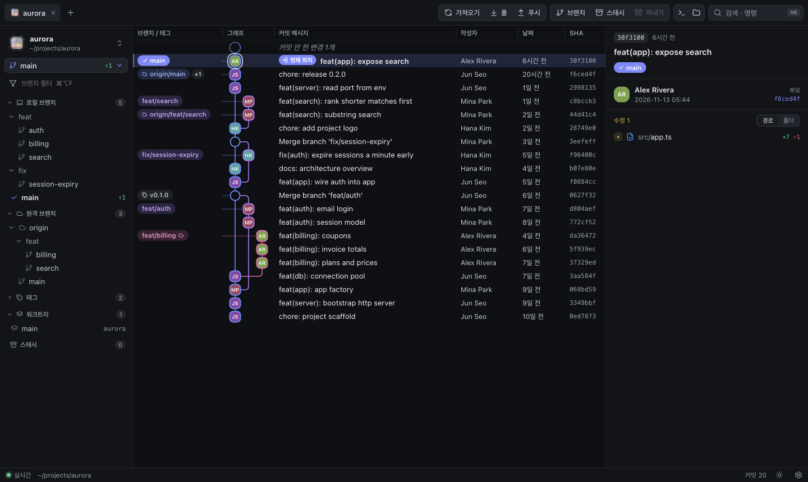
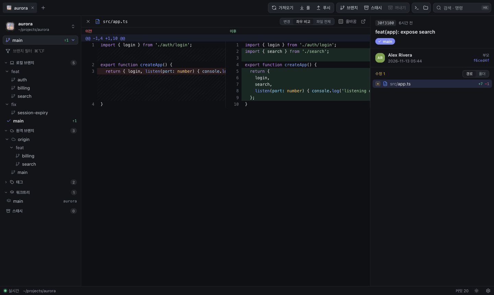
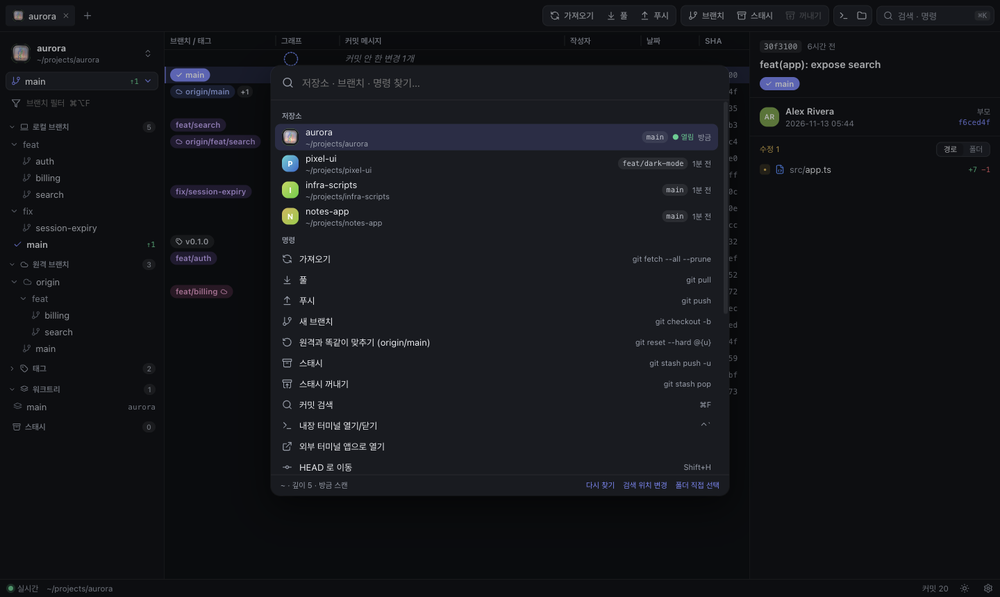
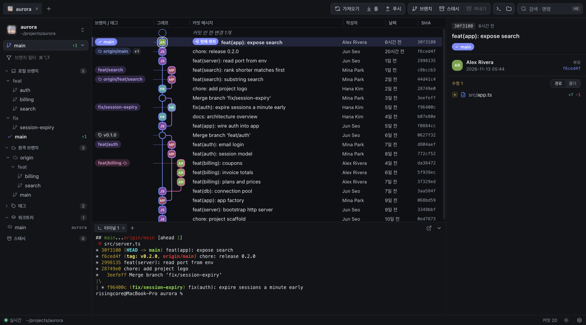
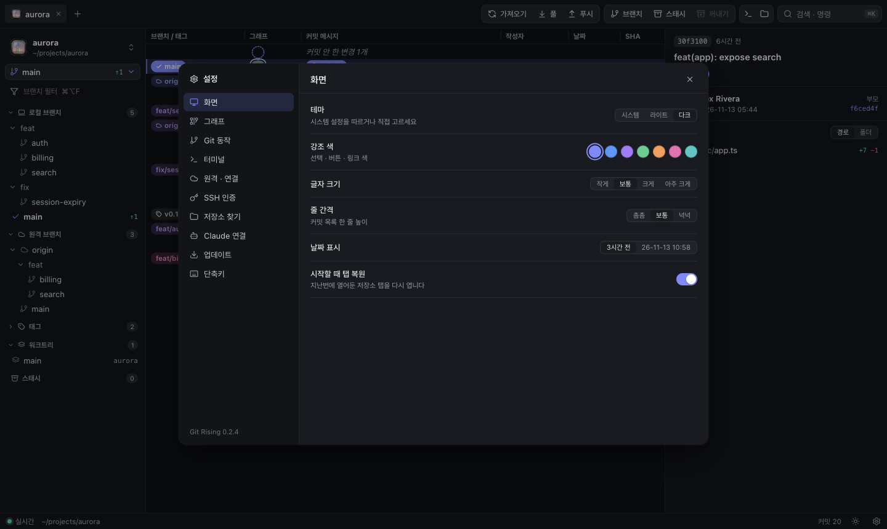

<div align="center">


# Git Rising

**가볍고 빠른 git 그래프 클라이언트** — macOS · Windows

브랜치를 한눈에 보고, 우클릭 한 번으로 리셋·머지·리베이스.<br>
폴링 없이 조용하고, 화면은 전부 한국어입니다.

[](https://github.com/odds-center/git-rising/releases/latest)
[](https://github.com/odds-center/git-rising/releases)


[**내려받기**](https://github.com/odds-center/git-rising/releases/latest) · [기능](#기능) · [Claude 연결](#claude-에서-쓰기-mcp) · [단축키](#단축키) · [개발](#개발)

<br>



</div>

<br>

## 설치

| | |
| --- | --- |
| **macOS** | [Releases](https://github.com/odds-center/git-rising/releases/latest) 에서 `git-rising-…-mac-arm64.dmg` (Apple Silicon) 또는 `…-mac-x64.dmg` (Intel) |
| **Windows** | `git-rising-…-win-x64.exe` |

> 서명되지 않은 앱이라 맥에서 처음 열 때는 **우클릭 → 열기** 를 한 번 해주세요.
> 그다음부터는 새 버전이 나오면 앱이 알려주고, 누르면 **스스로 업데이트**합니다.

시스템에 설치된 `git` 을 그대로 쓰기 때문에 SSH 키, 자격증명 도우미 등 평소 설정이 그대로 동작합니다.

## 기능

### 한눈에 보는 그래프

- 브랜치/태그 · 그래프 · 메시지 · 작성자 · 날짜 · SHA — 헤더 경계를 드래그해 너비 조절
- **지금 체크아웃한 위치**가 `현재 위치` 배지로 확실히 구분됩니다
- 커밋 작성자의 프로필 사진, 저장소·조직 로고
- 한 커밋에 브랜치가 여러 개면 `+N` 에 마우스를 올려 전부 확인
- `⌘F` 로 **전체 히스토리**에서 메시지·작성자·SHA 검색, 파일 우클릭 → 이 파일의 기록

### 우클릭 한 번으로

빨리감기 · 머지 · 리베이스 · **리셋 (soft / mixed / hard)** · 전환 · 새 브랜치 · 다른 브랜치를 여기로 옮기기 · 체리픽 · 되돌리기(revert) · 삭제 · 태그 · 링크 복사

- 예: `develop` 에서 `master` 우클릭 → **develop 을 master 로 리셋 → Hard**
- **원격과 똑같이 맞추기** — `fetch` + `reset --hard @{u}` 를 한 번에
- 방금 한 작업은 토스트의 **되돌리기** 또는 `⌘Z` 로 취소
- 메뉴마다 실제로 실행되는 git 명령이 옆에 표시됩니다

### 코드 보기 3가지



**변경**(통합 diff) · **좌우 비교**(이전/이후) · **파일 전체** — 문법 색상 포함.
이미지(이전/이후 비교) · PDF · 영상 · 오디오 · Word · 엑셀/CSV · Markdown 은 앱 안에서 미리보고, 그 밖의 형식은 기본 앱으로 엽니다.

### 저장소 자동 찾기 + 명령 팔레트



- 홈 폴더를 훑어 git 저장소를 찾아 **최근 작업 순**으로 보여줍니다 (`⌘O`)
- 워크트리는 따로 늘어놓지 않고 원래 저장소 아래로 묶습니다
- `⌘K` — 저장소 열기, 브랜치 전환, 모든 명령을 한 곳에서

### 워크트리를 워크트리답게

- 워크트리 탭에서는 브랜치를 둘러봐도 **체크아웃이 바뀌지 않습니다** — 전환하려면 명시적으로 고르고, 원래 저장소에서 전환할지 먼저 묻습니다
- 다른 워크트리에서 쓰는 브랜치는 사이드바에 표시되고, 전환하려 하면 *그 워크트리 열기 / 커밋만 보기 / 새 브랜치* 중에 고릅니다

### 내장 터미널



기본 셸이 그래프 아래에 뜹니다 (`` ⌃` ``). 탭 여러 개, 저장소별로 유지.

### 터미널 도우미 · AI 사용량

- **oh-my-zsh 업데이트를 자동으로** — 터미널을 열 때마다 묻지 않게 (설정 → 터미널)
- **입력 예측**(zsh-autosuggestions) · **명령 색상**(zsh-syntax-highlighting) 을 버튼 하나로 설치·켜기. `.zshrc` 를 고치기 전에 백업을 남깁니다
- 상태바에 **Claude Code · Codex 요금제 사용량(%)** 표시 (선택 사항 — 설정 → Claude 연결에서 켜기)

### 인증이 알아서

- **HTTPS · SSH 모두** 지원. 암호가 필요하면 앱 안에 입력 창이 뜨고, 맥은 키체인에 저장해 다음부터 자동
- 원격 추가 · 주소 변경 · HTTPS ↔ SSH 전환, URL 로 복제(clone)
- 가져오기는 원격별로 따로 — 원격 하나가 죽어 있어도 나머지는 받아옵니다

### 조용합니다

- **폴링 없음** — 파일이 바뀐 순간에만 갱신하고, 창이 뒤로 가면 감시를 멈춥니다
- 열려 있는 탭 하나만 감시하므로 워크트리가 많아도 CPU 를 쓰지 않습니다
- 보이는 줄만 그리고(재사용), 그래프 배치는 추가분만 계산, 상세·diff 는 캐시

### 설정



테마(다크 / 라이트 / 시스템) · 강조 색 · 글자 크기 · 줄 간격 · 아바타 · 컬럼 · 자동 가져오기 · 풀 방식 · 워크트리 보호 · 셸 …
탭과 설정은 컴퓨터에 저장되어 다시 열어도 그대로입니다.

### 한글 · 인코딩

EUC-KR(CP949) · Shift_JIS · GBK · UTF-16 파일도 diff 가 깨지지 않고, 맥의 자모 분리(NFD) 파일명도 정상 표시됩니다.

## Claude 에서 쓰기 (MCP)

Claude 가 Git Rising 을 통해 저장소를 찾고, 탭을 열고, 상태를 확인하고, git 작업을 실행합니다.

> “docca 레포 열어줘” · “develop 을 master 로 reset --hard 해줘” · “최근 커밋 요약해줘”

앱의 **설정 → Claude 연결 → 등록** 을 누르면 끝. 수동으로는:

```bash
claude mcp add --scope user git-rising -e ELECTRON_RUN_AS_NODE=1 -- \
  "/Applications/Git Rising.app/Contents/MacOS/Git Rising" \
  "/Applications/Git Rising.app/Contents/Resources/app/src/mcp.js"
```

| 도구 | 하는 일 |
| --- | --- |
| `list_repos` | 자동으로 찾은 저장소 목록 (최근 작업 순) |
| `open_repo` | 앱에서 저장소를 탭으로 열기 |
| `repo_overview` | 브랜치, ahead/behind, 변경사항, 최근 커밋 |
| `list_branches` · `repo_log` · `show_commit` · `search_commits` | 조회 |
| `git_action` | fetch · pull · push · checkout · reset · merge · rebase · … |
| `terminal_tools` | oh-my-zsh 업데이트 방식, 입력 예측·문법 강조 플러그인 |
| `set_scan_roots` | 저장소 검색 위치 변경 |

## 단축키

| 키 | 동작 | 키 | 동작 |
| --- | --- | --- | --- |
| `⌘K` | 명령 팔레트 | `⌘O` | 저장소 찾기 |
| `⌘F` | 커밋 검색 | `⌘⌥F` | 브랜치 필터 |
| `↑ ↓` / `j k` | 커밋 이동 | `Shift+H` | 현재 위치(HEAD)로 |
| `⌘Z` | 방금 한 작업 되돌리기 | `` ⌃` `` | 터미널 |
| `⌘1–9` | 탭 전환 | `⌘W` | 탭 닫기 |
| `Enter` | 첫 파일 diff | `?` | 단축키 도움말 |

탭은 드래그해서 순서를 바꿀 수 있고, 폴더를 창에 끌어다 놓으면 저장소가 열립니다.

## 개발

```bash
npm install
npm start                  # 개발 모드 (npm start -- /path/to/repo)
npm run install:mac        # 빌드해서 /Applications 에 설치
npm run check              # 타입 검사 (JS 를 tsc 로 검사, 빌드 단계 없음)
```

**릴리즈** — 태그를 올리면 GitHub Actions 가 mac/win 빌드를 Release 에 올리고, 설치된 앱들이 업데이트합니다.

```bash
npm version patch && git push --follow-tags
```

| 파일 | 역할 |
| --- | --- |
| `src/main.js` | Electron 메인. 로컬 서버(127.0.0.1, 매번 빈 포트)를 띄우고 창을 엶 |
| `src/server.js` | 시스템 `git` 을 호출하는 HTTP API, 파일 감시(SSE), 터미널(WebSocket + node-pty) |
| `src/updater.js` | GitHub Releases 기반 자동 업데이트 |
| `src/mcp.js` | MCP 서버 (stdio) |
| `public/` | 화면 — 바닐라 JS, canvas 그래프 |
